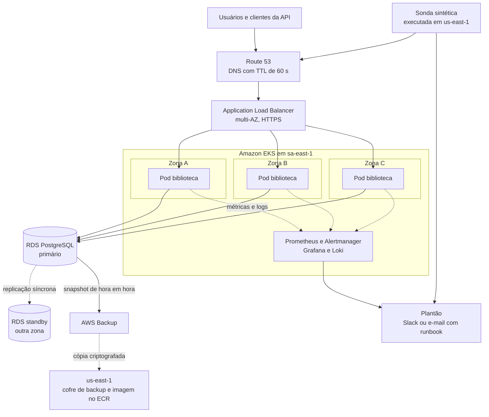
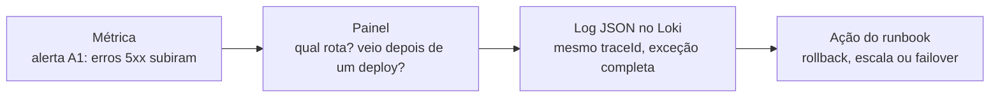

# Trabalho 7 — Observabilidade, Alta Disponibilidade e Recuperação de Desastres

**Serviço:** Biblioteca (Spring Boot 4 / Java 21), o mesmo do T5 e do T6.
**Plataforma:** Kubernetes no Amazon EKS, como no T3 ([`t3-biblioteca-multicloud`](https://github.com/Renan0204/t3-biblioteca-multicloud)), na região `sa-east-1` (São Paulo), com recuperação em `us-east-1`.

> **Premissas.** O pipeline do T5 gera e valida o pacote; o deploy e o rollback seguem a estratégia do T6. Tempos e capacidades são estimativas a confirmar nos testes da [seção 7.6](#76-testes-de-resiliência). A proposta vale também para AKS ou K3s, trocando os serviços gerenciados.

| Entregável (slide 38) | Seção |
|---|---|
| Diagrama da arquitetura | [2](#2-arquitetura-proposta) |
| Três ou mais SLIs | [3](#3-slis) |
| Dois SLOs | [4](#4-slos-e-orçamento-de-erro) |
| Painel mínimo | [5](#5-painel-mínimo-e-sinais) |
| Três alertas com ação | [6](#6-alertas) |
| Estratégia de alta disponibilidade | [7](#7-alta-disponibilidade-e-resiliência) |
| RPO e RTO justificados | [8](#8-rpo-e-rto) |
| Estratégia de DR | [9](#9-recuperação-de-desastres-backup-e-restore-entre-regiões) |
| Runbook resumido | [10](#10-runbook-rb-01-erros-5xx-na-consulta-ao-acervo) |
| Riscos e ajustes encontrados no código | [11](#11-ajustes-necessários-na-aplicação) e [12](#12-riscos-residuais) |

## 1. Operação crítica e experiência esperada

- **Quem usa:** alunos e professores consultam o acervo; bibliotecários cadastram livros, autores e usuários; sistemas externos usam a API REST com JWT.
- **Operação crítica:** consultar o acervo, em `GET /livros` (site) e `GET /api/livros` (API). Como todas as páginas exigem autenticação, o login (`POST /login` e `POST /api/auth/login`) faz parte da mesma jornada.
- **Experiência esperada:** entrar e ver a lista de livros sem erro, com resposta do servidor em até 400 ms.
- **Perfil dos dados:** muita leitura e pouca escrita (cadastros pontuais). Perder minutos de dados obriga a recadastrar poucos itens; perder o banco inteiro é inaceitável.

## 2. Arquitetura proposta



O que muda em relação ao T3:

| | T3 (hoje) | T7 (proposta) |
|---|---|---|
| Réplicas | 1 | 3 a 9, no mínimo uma por zona |
| Banco | H2 em memória, dentro do pod | RDS PostgreSQL Multi-AZ |
| Sessão do site | memória do pod | Spring Session JDBC, no PostgreSQL |
| Probes | `/login` nas três | Actuator: liveness sem dependências e readiness com o banco |
| Segredos | `Secret` criado à mão | Secrets Manager com External Secrets |
| Telemetria | log de console | métricas Prometheus, logs JSON no Loki e sonda externa |
| Backup | nenhum | AWS Backup de hora em hora, com cópia em `us-east-1` |

## 3. SLIs

| SLI | Eventos bons ÷ eventos válidos | Fonte | Por que |
|---|---|---|---|
| **SLI-1 Disponibilidade** | requisições sem erro do servidor (status < 500) ÷ requisições de usuários (exceto `/actuator/**`) | `http_server_requests_seconds_count`, label `outcome` | é o que o usuário percebe como "fora do ar" |
| **SLI-2 Latência da consulta** | consultas ao acervo (`/livros` e `/api/livros`) respondidas em até 400 ms ÷ consultas ao acervo | bucket `le="0.4"` do mesmo histograma | a lentidão aparece antes da queda |
| **SLI-3 Jornada sintética** | execuções bem-sucedidas da sonda (login na API e `GET /api/livros`) ÷ execuções | CloudWatch Synthetics, a cada 5 min, rodando em `us-east-1` | mede de fora: continua funcionando se o cluster, o Prometheus ou a região caírem |
| **SLI-4 Frescor do backup** | minutos desde a última cópia concluída em `us-east-1` | eventos do AWS Backup no CloudWatch | prova que o RPO prometido é real |

**Exclusões:** health checks do Kubernetes e do ALB (`/actuator/**`). Erros 4xx contam como sucesso do servidor, porque a falha é da requisição e não do serviço. Para isso valer, a aplicação precisa parar de responder 500 a pedidos inválidos ([seção 11](#11-ajustes-necessários-na-aplicação)).

```promql
# SLI-1: disponibilidade
sum(rate(http_server_requests_seconds_count{uri!~"/actuator.*", outcome!="SERVER_ERROR"}[5m]))
/
sum(rate(http_server_requests_seconds_count{uri!~"/actuator.*"}[5m]))

# SLI-2: latência da consulta ao acervo
sum(rate(http_server_requests_seconds_bucket{uri=~"/livros|/api/livros", le="0.4"}[5m]))
/
sum(rate(http_server_requests_seconds_count{uri=~"/livros|/api/livros"}[5m]))
```

Os nomes de métricas e labels acima foram conferidos localmente: com `spring-boot-starter-actuator` e `micrometer-registry-prometheus` no Spring Boot 4.0.6, o endpoint `/actuator/prometheus` expôs essas séries, e a propriedade `management.metrics.distribution.slo[http.server.requests]=400ms` gerou o bucket `le="0.4"`.

## 4. SLOs e orçamento de erro

| SLO | Meta | Janela | Orçamento de erro |
|---|---|---|---|
| **SLO-1 Disponibilidade** (SLI-1) | 99,5% das requisições sem erro do servidor | 30 dias móveis | 0,5%, o equivalente a 3 h 36 min de indisponibilidade total por mês |
| **SLO-2 Latência** (SLI-2) | 95% das consultas ao acervo em até 400 ms | 30 dias móveis | 5% das consultas podem passar de 400 ms |

**Por que 99,5% e não 99,9%:**

- O sistema é acadêmico. Uma indisponibilidade curta atrasa consultas, mas não causa perda financeira, e o balcão da biblioteca é uma alternativa.
- 99,9% deixa só 43 min por mês. Um failover do banco somado a um deploy problemático já estouraria a meta, e mantê-la com folga exigiria redundância entre regiões, quase dobrando o custo.
- 3 h 36 min acomodam o failover do banco (1 a 2 min), os deploys do T6 e um incidente moderado.
- É uma meta interna. Não há SLA contratual (slides 13 e 14).

**Política do orçamento de erro:**

| Consumo do orçamento | Decisão |
|---|---|
| menos de 50% | deploys normais, conforme o T6 |
| 50% ou mais antes do 15º dia da janela | só deploys de correção, sempre com o critério de promoção do T6 |
| 100% | congelar novas funcionalidades; a prioridade é confiabilidade até o SLI voltar à meta |

## 5. Painel mínimo e sinais

**Sinais coletados (slide 7):**

| Sinal | Como | Decisão |
|---|---|---|
| Métricas | Actuator e Micrometer expõem `/actuator/prometheus`; o Prometheus coleta a cada 15 s | base dos SLIs, do painel e dos alertas |
| Logs | JSON estruturado (`logging.structured.format.console=ecs`) com `traceId`, enviados pelo Fluent Bit ao Loki | explicam a falha que a métrica apontou |
| Traces | fase 2: OpenTelemetry enviando ao Grafana Tempo | hoje a aplicação é um monólito com uma dependência; o `traceId` nos logs já permite correlacionar. Coletar traces agora seria custo sem pergunta a responder |
| Eventos | anotação de deploy criada pelo pipeline | liga degradação a mudança |

**Ferramentas:** Prometheus, Alertmanager, Grafana e Loki (pacote `kube-prometheus-stack`). Funcionam igual no EKS, no AKS e no K3s do T3. Os serviços gerenciados da AWS (ALB, RDS, sonda e backup) já publicam métricas no CloudWatch, que o Grafana lê como segunda fonte de dados. Tudo fica num painel só.

**Proposta de layout (Grafana):**

```text
┌────────────────────┬────────────────────┬────────────────────┬────────────────────┐
│ ESTADO             │ SLO 30 DIAS        │ VOLUME             │ ERROS 5xx          │
│ ● OK · pods 3/3    │ 99,82% (meta 99,5%)│ req/s por rota     │ % por rota         │
│ sonda: OK há 2 min │ orçamento: 64%     │ ▁▂▃▅▆▅▃▂▁▂▃        │ ▁▁▁▁▃▁▁▁▁▁▁        │
├────────────────────┴────────────────────┼────────────────────┴────────────────────┤
│ LATÊNCIA DA CONSULTA (p50/p95/p99)      │ SATURAÇÃO                               │
│ ▁▂▂▃▂▂▁▂▃▂  ─ ─ ─ ─ 400 ms              │ CPU e memória dos pods                  │
│ SLO-2: 96,4% até 400 ms                 │ pool: ativas/máx./espera                │
├─────────────────────────────────────────┼─────────────────────────────────────────┤
│ BANCO (RDS)                             │ COMPARAÇÃO COM 7 DIAS ATRÁS             │
│ conexões, latência,                     │ volume, erros e latência                │
│ espaço livre, failover                  │ sobrepostos                             │
└─────────────────────────────────────────┴─────────────────────────────────────────┘
 ▲ anotações de deploy em todos os gráficos · links: logs no Loki e runbook RB-01
```

Os valores do desenho são ilustrativos.

| Painel (slide 18) | Fonte ou consulta | Para que serve |
|---|---|---|
| Estado | última execução da sonda (SLI-3) e pods prontos (`kube_deployment_status_replicas_available`) | responder em um segundo se o serviço está no ar |
| SLO e orçamento | SLI-1 em 30 dias e percentual do orçamento restante | decidir se dá para arriscar um deploy |
| Volume | `rate(http_server_requests_seconds_count[5m])` por `uri` | queda brusca de tráfego também é sintoma |
| Erros 5xx | SLI-1 por `uri` | localizar a rota com problema |
| Latência | p50, p95 e p99 com `histogram_quantile`, mais a linha de 400 ms | acompanhar o SLO-2 |
| Saturação | `process_cpu_usage`, `jvm_memory_used_bytes` e `hikaricp_connections_active`, `_max` e `_pending` | explicar a causa: pool esgotado, memória, CPU |
| Banco, a dependência crítica | CloudWatch do RDS: `DatabaseConnections`, `ReadLatency`, `WriteLatency`, `FreeStorageSpace` e eventos de failover | é a única dependência da aplicação |
| Eventos de deploy | anotações enviadas pelo pipeline | correlacionar degradação com mudança (T6) |
| Comparação temporal | as mesmas consultas com `offset 7d` | separar o padrão de horário de aula de uma anomalia |
| Investigação | links para o Loki filtrado por `traceId` e para o RB-01 | encurtar o caminho da métrica até a ação |

Correlação dos sinais neste serviço (slide 11):



## 6. Alertas

| Alerta | Sintoma | Condição: limite e janela | Severidade e responsável | Ação |
|---|---|---|---|---|
| **A1 Queima rápida do orçamento** | muitos erros 5xx | taxa de 5xx de 7,2% ou mais em 1 h **e** em 5 min | crítica: aciona o plantonista | [RB-01](#10-runbook-rb-01-erros-5xx-na-consulta-ao-acervo) |
| **A2 Jornada indisponível** | login e consulta falham vistos de fora | 2 falhas seguidas da sonda (10 min) | crítica: aciona o plantonista | RB-01, começando por DNS e ALB |
| **A3 Latência degradada** | consulta ao acervo lenta | menos de 95% das consultas em até 400 ms durante 15 min | alta: canal da equipe | ver saturação e banco no painel; se veio de deploy, rollback do T6 |
| **A4 Backup fora do RPO** | cópia em `us-east-1` atrasada | nenhuma cópia concluída há mais de 75 min | média: abre uma tarefa | reexecutar o job do AWS Backup; conferir permissões e a chave KMS |

- **Por que 7,2% no A1:** 7,2% é 14,4 vezes o orçamento de 0,5%. Nesse ritmo, 1 hora consome 2% do orçamento do mês. Exigir as duas janelas evita disparo por pico isolado e faz o alerta parar logo que o problema acaba. É a técnica de *burn rate* do livro de SRE do Google.
- **Plantonista:** rodízio semanal entre os integrantes. Métricas de causa (CPU, pool, conexões) ficam no painel e não acionam ninguém (slide 17).

Regra do A1 no Prometheus:

```yaml
groups:
  - name: biblioteca-slo
    rules:
      - alert: QueimaRapidaOrcamentoDeErro
        expr: |
          (
            sum(rate(http_server_requests_seconds_count{uri!~"/actuator.*", outcome="SERVER_ERROR"}[1h]))
            / sum(rate(http_server_requests_seconds_count{uri!~"/actuator.*"}[1h]))
          ) > 0.072
          and
          (
            sum(rate(http_server_requests_seconds_count{uri!~"/actuator.*", outcome="SERVER_ERROR"}[5m]))
            / sum(rate(http_server_requests_seconds_count{uri!~"/actuator.*"}[5m]))
          ) > 0.072
        labels:
          severity: critical
        annotations:
          summary: "Erros 5xx consumindo o orçamento 14,4 vezes mais rápido que o permitido"
          runbook_url: "https://github.com/Renan0204/biblioteca/blob/master/docs/T7-observabilidade-ha-dr.md#10-runbook-rb-01-erros-5xx-na-consulta-ao-acervo"
```

## 7. Alta disponibilidade e resiliência

### 7.1 Pré-requisito: aplicação sem estado

Hoje a aplicação não pode ter mais de uma réplica, e o próprio manifest do T3 avisa isso. A [seção 11](#11-ajustes-necessários-na-aplicação) lista os ajustes; três deles liberam a escala horizontal: banco externo (RDS), sessão no banco (Spring Session JDBC) e carga inicial de usuários idempotente.

### 7.2 Redundância e failover

| Componente | Redundância | Falha tolerada | Como o failover acontece |
|---|---|---|---|
| Pods | no mínimo 3, espalhados por zona (`topologySpreadConstraints`), com `PodDisruptionBudget` de `minAvailable: 2` | pod, nó ou zona inteira | a readiness falha e o ALB tira o pod em 20 a 30 s; o Kubernetes recria o pod |
| Nós | node group gerenciado em 3 zonas, com Cluster Autoscaler | nó ou zona | os pods são reagendados nos nós restantes |
| Entrada | ALB multi-AZ criado pelo AWS Load Balancer Controller | zona | o ALB só envia tráfego para destinos saudáveis |
| Banco | RDS PostgreSQL Multi-AZ, com standby síncrono | instância ou zona do banco | o RDS promove o standby em 60 a 120 s; o endpoint DNS não muda e o pool reconecta |
| Segredos | Secrets Manager, com réplica em `us-east-1`, e External Secrets | recriação do cluster | o segredo volta sem passo manual |

### 7.3 Health checks

| Probe | Endpoint | Configuração | Por quê |
|---|---|---|---|
| startup | `/actuator/health/liveness` | até 30 tentativas a cada 5 s, como no T3 | o Spring Boot leva alguns segundos para subir |
| liveness | `/actuator/health/liveness` | a cada 20 s | olha só o processo. Se dependesse do banco, uma queda do banco reiniciaria todos os pods ao mesmo tempo |
| readiness | `/actuator/health/readiness`, incluindo o banco | a cada 10 s; o ALB usa o mesmo endpoint | tira do balanceador o pod que não consegue atender |

O Actuator roda na porta 8081, que não é exposta pelo Ingress. A configuração de segurança libera sem login apenas `/actuator/health/**` e `/actuator/prometheus`.

### 7.4 Escalabilidade

- **Horizontal (escolhida):** HPA de 3 a 9 réplicas, com alvo de 60% de CPU, reduzindo réplicas só depois de 5 min estáveis para evitar oscilação. A aplicação subiu em 6,5 s no teste local do T5, então uma réplica nova entra em menos de 1 min, contando o agendamento.
- **Limite de custo e de banco:** 9 réplicas com pool de 10 conexões somam 90 conexões, que precisam caber no `max_connections` da instância do RDS.
- **Vertical (complemento):** ajustar `requests` e `limits` (hoje 250m/384Mi e 1 CPU/768Mi) pelo painel de saturação. Sozinha, ela não resolve, porque mantém a falha concentrada numa instância (slide 24).

### 7.5 Padrões de resiliência

| Padrão (slide 28) | Aplicação no Biblioteca |
|---|---|
| Timeout | o pool espera no máximo 3 s por uma conexão (`spring.datasource.hikari.connection-timeout=3000`); consultas limitadas a 5 s |
| Retry com limite e backoff | só na sonda e na reconexão ao banco após um failover. Cadastros não têm retry automático, para não duplicar livros |
| Bulkhead | pool de conexões limitado por pod: um pod com problema não esgota o banco dos outros |
| Degradação graciosa | se o banco cair, responder 503 com página amigável (já existem páginas de erro 403 e 404; faltam 500 e 503), e a readiness tira o pod do ar |
| Circuit breaker | não adotado agora: a única dependência é o banco, já protegida por timeout, pool e readiness. Volta a ser avaliado se surgir uma dependência externa |

### 7.6 Testes de resiliência

| Teste | Como | O que validar | Frequência |
|---|---|---|---|
| Queda de pod | `kubectl delete pod` | a sonda não registra erro e o pod é recriado | mensal |
| Queda de nó | `kubectl drain` de um nó | o PDB é respeitado e a capacidade se mantém | trimestral |
| Failover do banco | `aws rds reboot-db-instance --force-failover` | tempo real de failover; o A1 não deve disparar | trimestral |
| Restauração em `us-east-1` | runbook de DR completo, em homologação | RPO e RTO medidos ([seção 8](#8-rpo-e-rto)) | trimestral |
| Alerta de teste | forçar o A1 em homologação | a notificação chega e o runbook funciona | a cada mudança nos alertas |

## 8. RPO e RTO

| Cenário | RPO | RTO | Mecanismo |
|---|---|---|---|
| Falha de pod ou nó | 0 | menos de 1 min | réplicas, probes e ALB |
| Falha de uma zona | 0 | menos de 5 min | réplicas em 3 zonas e RDS Multi-AZ (failover em 60 a 120 s) |
| Erro humano ou dado corrompido | até 5 min | menos de 1 h | restauração para um ponto no tempo (PITR) do RDS, com retenção de 14 dias |
| **Perda da região `sa-east-1`** | **até 1 h** | **até 4 h** | backup e restore em `us-east-1` ([seção 9](#9-recuperação-de-desastres-backup-e-restore-entre-regiões)) |

**Justificativa:**

- **Impacto:** horas sem o sistema atrasam consultas, mas não há perda financeira nem risco à segurança, e o atendimento no balcão continua.
- **Dados:** livros, autores e usuários mudam pouco. Perder até 1 h significa recadastrar poucos itens, a partir dos registros da própria biblioteca.
- **Custo:** RTO de minutos para um desastre regional exigiria warm standby ou active-active, ou seja, uma segunda infraestrutura ligada o tempo todo.
- **RPO de 1 h é viável:** o AWS Backup tira um snapshot por hora e copia para `us-east-1`. O alerta A4 avisa se a cópia atrasar.
- **RTO de 4 h é viável:** a estimativa abaixo soma cerca de 1 h 45 min. A folga cobre a decisão humana e imprevistos, e o tempo real será medido no teste trimestral.

```mermaid
gantt
    title Recuperação após perda de sa-east-1, estimativa (meta de RTO 4 h)
    dateFormat HH:mm
    axisFormat %H:%M
    section Decisão
    Detectar e avaliar com os alertas A1 e A2 :a1, 00:00, 20m
    Declarar desastre                         :a2, after a1, 10m
    section Recuperação em us-east-1
    Restaurar o banco do último snapshot      :b1, after a2, 40m
    Criar o cluster EKS por IaC               :b2, after a2, 30m
    Aplicar manifests e segredos              :b3, after b2, 15m
    section Retorno
    Smoke tests do T6 e troca do DNS          :c1, after b3, 20m
    Comunicar os usuários                     :c2, after c1, 10m
```



## 9. Recuperação de desastres: backup e restore entre regiões

**Escolha:** backup e restore (slide 33). Atende ao RPO de 1 h e ao RTO de 4 h com o menor custo. O pilot light, com uma réplica do banco ligada em `us-east-1`, fica como evolução se o SLO subir ou o uso crescer.

| Parte | Como fica protegida |
|---|---|
| Dados | AWS Backup: snapshot de hora em hora (retenção de 14 dias) e diário (35 dias), criptografado com KMS e copiado para um cofre em `us-east-1` numa **outra conta AWS**, com Vault Lock (ninguém apaga antes do prazo) |
| Aplicação | imagem no ECR com replicação para `us-east-1`; manifests Kubernetes versionados no Git |
| Infraestrutura | cluster, banco e rede descritos como código (Terraform ou eksctl), exercitados na restauração trimestral |
| Configuração e segredos | Secrets Manager com réplica em `us-east-1` |
| Entrada | Route 53 com TTL de 60 s; o registro passa a apontar para o ALB de `us-east-1` depois da declaração de desastre |

**Backup confiável (slide 34):**

| Requisito | Como é atendido |
|---|---|
| Escopo definido | o banco é copiado; a aplicação é reconstruída a partir do Git e do ECR |
| Criptografado | KMS |
| Retenção e cópias isoladas | 14 e 35 dias, em outra região e outra conta, com Vault Lock |
| Monitorado | SLI-4 e alerta A4 |
| Restauração testada | teste trimestral em `us-east-1`, medindo RPO e RTO |
| Atende ao RPO | snapshot de hora em hora para um RPO de 1 h |
| Não depende do ambiente que protege | outra região e outra conta |

**Pessoas e processo (slide 30):**

- **Quem declara o desastre:** o plantonista, junto com o líder da equipe.
- **Quando:** região indisponível há mais de 30 min sem previsão no AWS Health Dashboard, ou perda de dados que o PITR da região não resolve.
- **Comunicação:** aviso aos usuários no início, a cada 30 min e no retorno.
- **Volta para `sa-east-1`:** planejada depois, fora do horário de aula, repetindo o processo no sentido inverso.

## 10. Runbook RB-01: erros 5xx na consulta ao acervo

**Gatilho:** alerta A1 ou A2. **Dono:** plantonista da semana.

1. **Avaliar o impacto (até 5 min).** No painel, verificar se a sonda externa está falhando, quantos pods estão prontos, quais rotas têm erro e se o problema começou logo após um deploy (anotação). Registrar a hora de início no canal do incidente.
2. **Mitigar pelo caminho mais provável:**

   | Se o painel mostra | Ação segura | Como reverter |
   |---|---|---|
   | erros começaram logo após um deploy | rollback pelo pipeline, conforme o plano do T6 | reaplicar a versão nova depois da correção |
   | readiness `DOWN` com o banco fora e evento de failover no RDS | aguardar até 2 min e confirmar a promoção do standby | não se aplica |
   | pool esgotado (`hikaricp_connections_pending` acima de 0) com latência alta | aumentar réplicas (`kubectl scale`), respeitando o limite de conexões do RDS | voltar ao mínimo do HPA |
   | pods reiniciando por falta de memória (`OOMKilled`) | subir o limite para 1Gi, como já previsto no T3 | reverter o manifest pelo Git |
   | problema na região (AWS Health Dashboard) | avaliar a declaração de desastre ([seção 9](#9-recuperação-de-desastres-backup-e-restore-entre-regiões)) | não se aplica |

3. **Confirmar a causa nos logs.** No Loki, `{app="biblioteca"} |= "ERROR"`, e depois filtrar pelo `traceId` de uma requisição com erro.
4. **Escalonar.** Sem mitigação em 15 min, chamar o segundo integrante. Em 30 min, o líder decide sobre DR e suporte da AWS.
5. **Comunicar.** Avisar no canal dos usuários quando o impacto for confirmado, a cada 30 min e no encerramento.
6. **Encerrar e aprender.** Considerar resolvido com o SLI-1 normal por 15 min. Registrar a linha do tempo, fazer a revisão sem culpados em até 48 h e atualizar este runbook.

## 11. Ajustes necessários na aplicação

Encontrados na leitura do código e num teste local com o Actuator ligado:

| Achado no código | Efeito em observabilidade e HA | Ajuste proposto |
|---|---|---|
| Banco H2 em memória (`jdbc:h2:mem:banco`) | cada pod tem o próprio banco, os dados somem a cada reinício e o RPO é "tudo"; impede mais de uma réplica | PostgreSQL no RDS Multi-AZ, com credenciais vindas do Secrets Manager |
| Sessão do login web na memória do pod | com várias réplicas, o usuário perde o login quando cai em outro pod | Spring Session JDBC no próprio PostgreSQL |
| `CommandLineRunner` cria `admin` e `user` a cada início | com banco persistente, cada pod que sobe duplica os usuários; `findByLogin` espera um resultado único e o login quebra | carga inicial idempotente (criar só se não existir) e índice único em `login` |
| `spring.jpa.hibernate.ddl-auto=update` | várias réplicas alterando o schema ao mesmo tempo | migrações versionadas com Flyway |
| `GET /api/livros/{id}` inexistente responde **500** (`findById(id).get()`, também em autores e usuários) | erro do cliente vira erro do servidor, consome o orçamento e pode disparar o A1 | responder 404 (`orElseThrow` com `ResponseStatusException`) |
| `GET /api/livros` com acervo vazio responde **404** (também em autores) | a sonda sintética falharia com o banco vazio | responder 200 com lista vazia |
| `catch (Exception e)` responde **501** sem registrar log | a métrica acusa o erro, mas o log não explica a falha | registrar a exceção com o `traceId` e responder 500 ou 503 |
| Probes do T3 em `/login` | a página de login não consulta o banco: a readiness não percebe o banco fora, e liveness e readiness são iguais | probes do Actuator ([seção 7.3](#73-health-checks)) |
| Logs em texto, sem correlação | difícil cruzar log com métrica | logs JSON com `traceId` |

Configuração proposta para o Actuator (dependências `spring-boot-starter-actuator` e `micrometer-registry-prometheus`):

```properties
management.server.port=8081
management.endpoints.web.exposure.include=health,prometheus
management.endpoint.health.probes.enabled=true
management.endpoint.health.group.readiness.include=readinessState,db
management.metrics.distribution.slo[http.server.requests]=400ms
management.metrics.distribution.percentiles-histogram[http.server.requests]=true
logging.structured.format.console=ecs
```

## 12. Riscos residuais

| Risco | Mitigação |
|---|---|
| Operação normal em uma única região | DR por backup e restore com RTO de 4 h, aceito pelo impacto do serviço |
| Observabilidade dentro do mesmo cluster (o Prometheus cai junto) | sonda e alertas A2 e A4 rodam no CloudWatch, fora do cluster |
| Fadiga de alertas | só sintomas acionam o plantão; revisão mensal dos alertas que dispararam sem ação |
| Failover e restauração nunca testados | calendário de testes da [seção 7.6](#76-testes-de-resiliência) |
| Custo de Multi-AZ, 3 zonas e EKS | mínimo de réplicas medido pelo painel; revisão na Aula 13 (FinOps) |
| Esgotar as conexões do RDS ao escalar | máximo do HPA multiplicado pelo pool por pod fica abaixo do `max_connections` |
| Segredo JWT compartilhado entre réplicas | Secrets Manager; uma rotação invalida os tokens ativos, que valem 24 h, então deve ser feita em janela planejada |

## Referências

- RANGHETTI. *Aula 12 — Observabilidade, Alta Disponibilidade e Recuperação de Desastres*. Disponível em: <https://github.com/dpRanghetti/UniALFA/blob/master/Cloud%20Computing%20e%20DevOps%20Avan%C3%A7ado/aula_12_observabilidade_alta_disponibilidade_dr.md>.
- GOOGLE. *Site Reliability Engineering* e *The Site Reliability Workbook* (capítulo sobre alertas por SLO). Disponível em: <https://sre.google/books/>.
- AWS. *Disaster Recovery of Workloads on AWS*. Disponível em: <https://docs.aws.amazon.com/whitepapers/latest/disaster-recovery-workloads-on-aws/disaster-recovery-options-in-the-cloud.html>.
- SPRING. *Spring Boot Actuator*. Disponível em: <https://docs.spring.io/spring-boot/reference/actuator/>.
- OPENTELEMETRY. *Documentation*. Disponível em: <https://opentelemetry.io/docs/>.
